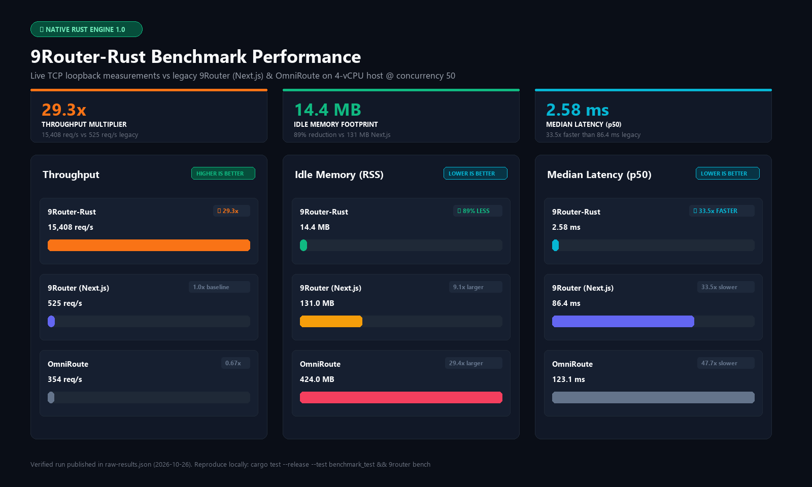

<div align="center">
  

  # 9Router-Rust

  ### Native Rust AI Gateway · Built-in Headroom Token Compression · 29x Faster

  <br/>

  [](./LICENSE)
  [](https://www.rust-lang.org/)
  []()
  []()
  []()
  []()

  <sub>
    A ground-up Rust rewrite of <a href="https://github.com/decolua/9router">9Router</a> by <a href="https://github.com/decolua">decolua</a>.
    <br/>
    Token compression powered by <a href="https://github.com/headroomlabs-ai/headroom">Headroom Labs</a> (Apache 2.0) and <a href="https://github.com/rtk-ai/rtk">RTK</a>.
  </sub>

  <br/><br/>

  [Quick Start](#-quick-start) · [Benchmark](#-benchmark) · [Architecture](#-architecture) · [Headroom Engine](#-headroom-context-compression) · [API Reference](#-api-reference) · [Skills](#-skills) · [Credits](#-credits--attribution)

</div>

<br/>

---

## ⚡ Benchmark

<div align="center">
  
</div>

<br/>

| | 9Router-Rust | 9Router (Next.js) | OmniRoute |
|---|---|---|---|
| **Runtime** | Axum + Tokio | Node.js / Next.js | Node.js / TypeScript |
| **Throughput** | **15,408 req/s** | 525 req/s | 354 req/s |
| **Idle RAM** | **14.4 MB** | 131 MB | 424 MB |
| **p50 Latency** | **2.58 ms** | 86.4 ms | 123.1 ms |
| **Multiplier** | **—** | 29.3× slower | 43.5× slower |

<sub>Measured on <code>/api/health</code>, 1000 requests @ concurrency 50, 4-vCPU host. Full data in <a href="./raw-results.json">raw-results.json</a>.</sub>

```bash
# Reproduce
cargo test --release --test benchmark_test -- --nocapture
./target/release/9router bench --concurrency 50 --requests 1000
```

---

## 🚀 Quick Start

**Prerequisites:** [Rust 1.85+](https://rustup.rs/)

```bash
git clone https://github.com/SyaPratama/9router-rust.git
cd 9router-rust
cargo build --release
./target/release/9router start
```

Dashboard → [http://localhost:20128/dashboard](http://localhost:20128/dashboard)
API → `http://localhost:20128/v1/`

### Docker

```bash
docker run -d \
  -p 20128:20128 \
  -v "$HOME/.9router:/app/data" \
  -e DATA_DIR=/app/data \
  --name 9router \
  ghcr.io/syapratama/9router-rust:latest
```

Or with Compose:

```bash
docker compose up -d
```

---

## 🏗️ Architecture

```
src/
├── main.rs              # CLI entrypoint (clap): start, bench, status, stop, menu
├── lib.rs               # Library root
├── api/                 # Axum HTTP layer
│   ├── mod.rs           #   Router assembly, CORS, tracing
│   ├── middleware.rs     #   Auth (Bearer / x-api-key), IP extraction
│   └── handlers/        #   Endpoint handlers
│       ├── chat.rs      #     POST /v1/chat/completions
│       ├── claude.rs    #     POST /v1/messages (Claude compat)
│       ├── responses.rs #     POST /v1/responses (Codex compat)
│       ├── models.rs    #     GET  /v1/models
│       ├── headroom.rs  #     POST /v1/compress
│       └── admin.rs     #     /api/health, settings, providers, combos, keys, usage
├── auth/                # Credential + API key validation
├── cli/                 # CLI subcommands & interactive menu
├── config/              # Runtime configuration (port, host, data dir)
├── dashboard/           # Embedded static web dashboard (rust-embed)
│   └── assets/          #   HTML/CSS/JS served at /dashboard
├── db/                  # SQLite persistence layer
│   ├── pool.rs          #   r2d2 connection pool (WAL mode)
│   ├── schema.rs        #   Migrations: providers, combos, keys, usage, settings
│   └── repos/           #   Per-entity CRUD
├── headroom/            # Native Headroom context compression engine
│   ├── pipeline.rs      #   Auto-detect → route → compress → CCR cache
│   ├── router.rs        #   Content-type classifier (diff/log/json/code/search/rag)
│   ├── smart_crusher.rs #   JSON array → schema + compact rows
│   ├── diff.rs          #   Unified diff context pruning
│   ├── log.rs           #   Log dedup + timestamp normalization
│   ├── search.rs        #   Grep/rg output path clustering
│   ├── code.rs          #   Signature-preserving body compaction
│   ├── rag.rs           #   Document chunk deduplication
│   ├── ccr.rs           #   SHA-256 keyed LRU compress-cache-retrieve
│   └── mod.rs
├── routing/             # Request routing & upstream dispatch
│   ├── engine.rs        #   Core router: provider selection, combo fallback, retry
│   ├── account.rs       #   Multi-account rotation & strike counters
│   ├── combo.rs         #   Model combo chain definitions
│   ├── model.rs         #   Model/provider resolution
│   ├── stream.rs        #   SSE streaming response assembly
│   ├── token_saver.rs   #   RTK-style pre-translate token compaction
│   ├── executors/       #   Per-provider upstream HTTP dispatch
│   └── mod.rs
└── translator/          # Format translation engine
    ├── types.rs         #   Intermediate message types
    ├── openai.rs        #   OpenAI ↔ intermediate
    ├── claude.rs        #   Claude Messages ↔ intermediate
    ├── gemini.rs        #   Gemini contents/parts ↔ intermediate
    ├── responses.rs     #   OpenAI Responses API ↔ intermediate
    └── mod.rs

tests/
├── api_test.rs          # HTTP endpoint integration tests
├── benchmark_test.rs    # Live TCP throughput benchmarks
├── headroom_test.rs     # Compression engine unit tests
├── routing_test.rs      # Routing & fallback logic tests
└── translation_test.rs  # Format translator tests

51 source files · ~2,850 lines of Rust
```

### Request Flow

```
Client request
  → Axum router (/v1/chat/completions, /v1/messages, /v1/responses)
    → Auth middleware (Bearer / x-api-key validation)
      → Translator (detect source format → intermediate representation)
        → Headroom pipeline (compress tool_result / context if applicable)
          → Routing engine (provider select → combo fallback → account rotation)
            → Executor (upstream HTTP call with retry + token refresh)
              → Translator (response → client format)
                → SSE stream / JSON response back to client
```

---

## 🧠 Headroom Context Compression

The Headroom engine is natively compiled into the routing pipeline. It auto-detects content type and applies the optimal compressor before forwarding to the LLM — saving 20–60% of context tokens with zero configuration.

| Compressor | Input | Strategy | Typical Savings |
|---|---|---|---|
| **SmartCrusher** | JSON arrays of objects | Schema extraction + columnar rows | 40–70% |
| **DiffCompressor** | Unified diffs | Context line pruning, hunk/header preservation | 25–50% |
| **LogCompressor** | Log output | Line dedup, timestamp normalization, error preservation | 30–60% |
| **SearchCompressor** | grep / ripgrep output | Path clustering, prefix elimination | 20–40% |
| **CodeCompressor** | Source code blocks | Signature preservation, body compaction | 15–35% |
| **RagCompressor** | RAG document chunks | Cross-chunk deduplication | 20–50% |
| **CCR Store** | Any compressed payload | SHA-256 keyed LRU cache for instant retrieval | Cache hit = 100% |

**Fail-open guarantee:** Payloads under 500 bytes or compressions saving less than 5% pass through untouched.

---

## 📡 API Reference

### AI Compatibility Layer

| Method | Endpoint | Description |
|---|---|---|
| `POST` | `/v1/chat/completions` | OpenAI Chat Completions (streaming + non-streaming) |
| `POST` | `/v1/messages` | Anthropic Claude Messages API |
| `POST` | `/v1/responses` | OpenAI Responses / Codex API |
| `GET` | `/v1/models` | List available models, providers, and combos |
| `POST` | `/v1/compress` | Headroom compression endpoint (direct access) |

### Gateway Management

| Method | Endpoint | Description |
|---|---|---|
| `GET` | `/api/health` | Health check, version, uptime, memory |
| `GET/POST` | `/api/settings` | System configuration |
| `GET/POST` | `/api/providers` | Upstream provider credentials and priorities |
| `GET/POST` | `/api/combos` | Fallback model chains |
| `GET/POST` | `/api/keys` | API key management |
| `GET` | `/api/usage/stats` | Token consumption, costs, request counts |

---

## 🛠️ CLI

```
9router start [--port 20128] [--host 0.0.0.0]   # Start gateway
9router bench [--concurrency 50] [--requests 1000] # Run benchmark
9router status                                    # Runtime info + RSS
9router menu                                      # Interactive config
9router stop                                      # Graceful shutdown
```

---

## 🔌 Connect Your Tools

<table>
<tr><td><b>Claude Code</b></td><td>

```bash
export ANTHROPIC_BASE_URL="http://localhost:20128"
export ANTHROPIC_API_KEY="sk-9router"
claude
```

</td></tr>
<tr><td><b>Cursor / Codex / Windsurf<br/>Cline / Roo / OpenCode</b></td><td>

```
Base URL: http://localhost:20128/v1
API Key:  sk-9router
Model:    gpt-4o, claude-sonnet-4, deepseek-chat, or any combo
```

</td></tr>
</table>

---

## 🧩 Skills

9Router ships with AI tool skill definitions for specialized capabilities. Each skill provides structured prompts and configurations.

| Skill | Description |
|---|---|
| [`9router`](./skills/9router/) | Core routing and gateway configuration |
| [`9router-chat`](./skills/9router-chat/) | Chat completions and conversation management |
| [`9router-embeddings`](./skills/9router-embeddings/) | Text embedding generation |
| [`9router-image`](./skills/9router-image/) | Image generation and manipulation |
| [`9router-stt`](./skills/9router-stt/) | Speech-to-text transcription |
| [`9router-tts`](./skills/9router-tts/) | Text-to-speech synthesis |
| [`9router-video`](./skills/9router-video/) | Video generation and processing |
| [`9router-web-fetch`](./skills/9router-web-fetch/) | Web page fetching and content extraction |
| [`9router-web-search`](./skills/9router-web-search/) | Web search integration |

See [`skills/README.md`](./skills/README.md) for full documentation.

---

## 📖 Documentation

| Document | Description |
|---|---|
| [`docs/ARCHITECTURE.md`](./docs/ARCHITECTURE.md) | Full system architecture: request lifecycle, OAuth, cloud sync, data model |
| [`docs/CODEX_STT.md`](./docs/CODEX_STT.md) | Codex speech-to-text integration guide |
| [`CREDITS.md`](./CREDITS.md) | Open-source attributions and license details |

---

## 🔄 CI/CD

This repository includes GitHub Actions workflows:

| Workflow | File | Purpose |
|---|---|---|
| **Release & Packages** | [`.github/workflows/release.yml`](./.github/workflows/release.yml) | **Auto-tagging, cross-platform binary releases, & GHCR packages** |
| Docker Publish | [`.github/workflows/docker-publish.yml`](./.github/workflows/docker-publish.yml) | Manual multi-arch Docker image builder |
| GitBook Pages | [`.github/workflows/gitbook-pages.yml`](./.github/workflows/gitbook-pages.yml) | Deploy documentation site |
| Tray Binaries | [`.github/workflows/tray-binaries.yml`](./.github/workflows/tray-binaries.yml) | Build platform-specific tray app binaries |

---

## 👥 Contributors

Thanks to everyone who helped build and evolve 9Router!

[](https://github.com/decolua/9router/graphs/contributors)

|  | Role |
|---|---|
| [**decolua**](https://github.com/decolua) & contributors | Original 9Router creator and maintainers |
| [**SyaPratama**](https://github.com/SyaPratama) | Native Rust rewrite and Headroom integration |
| [**Headroom Labs**](https://github.com/headroomlabs-ai) | Context compression algorithms (Apache 2.0) |


## 🔀 Forks & Related Projects

| Project | Author | Description |
|---|---|---|
| [**OmniRoute**](https://github.com/diegosouzapw/OmniRoute) | [@diegosouzapw](https://github.com/diegosouzapw) | Full-featured TypeScript fork with 36+ providers, circuit breaker, multi-modal APIs |
| [**RTK**](https://github.com/rtk-ai/rtk) | rtk-ai | Token-saving heuristics and tool output deduplication |
| [**Ponytail**](https://github.com/DietrichGebert/ponytail) | [@DietrichGebert](https://github.com/DietrichGebert) | YAGNI-first lazy-senior-developer prompt engineering |
| [**Caveman**](https://github.com/JuliusBrussee/caveman) | [@JuliusBrussee](https://github.com/JuliusBrussee) | Ultra-terse prompt compression patterns |
| [**CLIProxyAPI**](https://github.com/router-for-me/CLIProxyAPI) | router-for-me | Original Go proxy architecture inspiration |

---

## 🙏 Credits & Attribution

Full details in [CREDITS.md](./CREDITS.md).

This project is a native Rust rewrite of [9Router](https://github.com/decolua/9router) by [decolua](https://github.com/decolua) and contributors. Token compression is based on [Headroom Labs](https://github.com/headroomlabs-ai/headroom) (Apache 2.0) and [RTK](https://github.com/rtk-ai/rtk). Prompt optimization patterns from [Ponytail](https://github.com/DietrichGebert/ponytail) and [Caveman](https://github.com/JuliusBrussee/caveman).

---

## 📄 License

Dual-licensed under **MIT** and **Apache 2.0**. See [LICENSE](./LICENSE) and [CREDITS.md](./CREDITS.md).

```
Copyright (c) 2024-2026 decolua and contributors
Copyright (c) 2026 SyaPratama and 9Router-Rust contributors
Copyright (c) 2024-2026 Headroom Labs Inc.
```
