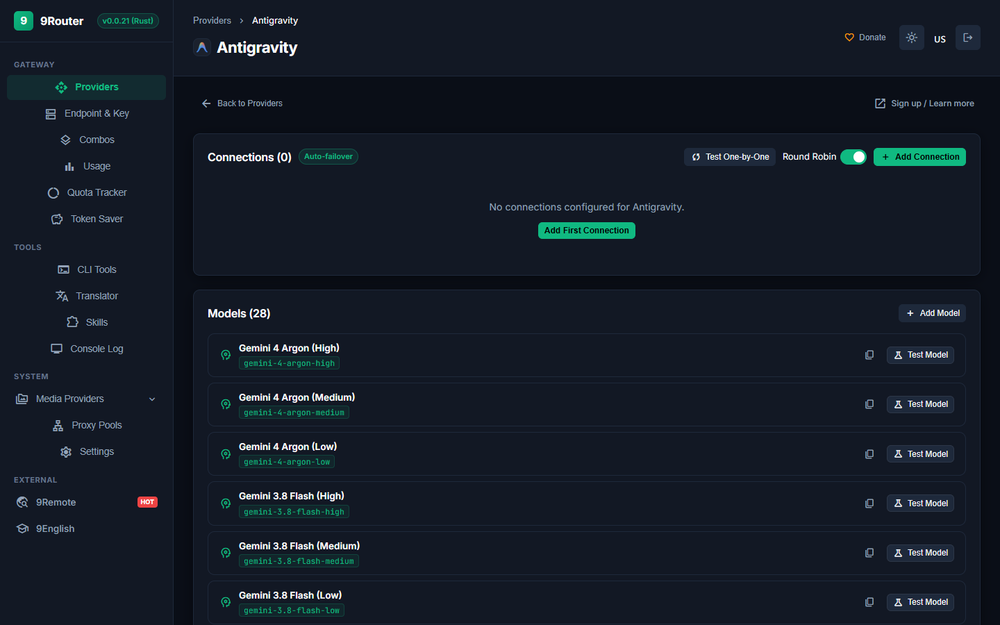
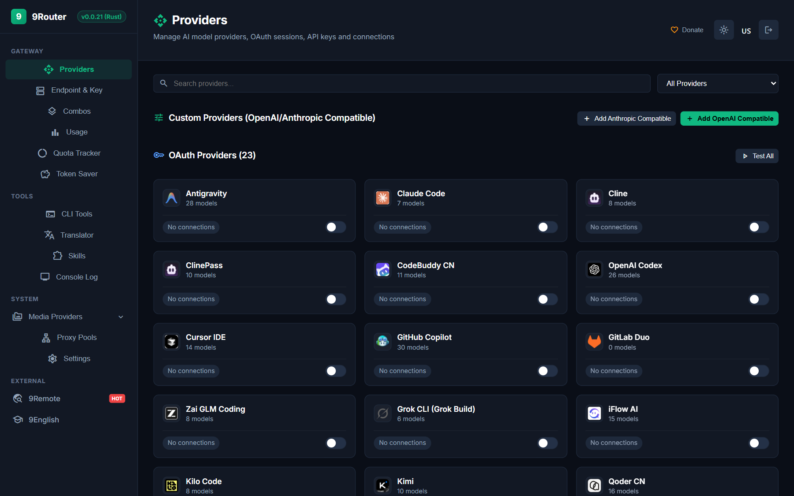

<div align="center">
  

  # 9Router - Native Rust AI Gateway & Token Saver

  **Save 20-60% tokens with built-in Headroom + auto-fallback to FREE & cheap AI models.**

  **Connect all AI Coding Agents (Claude Code, Cursor, Windsurf, Codex, Gemini, OpenCode, Cline, Roo Code...) to 142 AI Providers, 100+ Models, and 23+ Injected Agent Skills.**

  [](./LICENSE)
  [](https://www.rust-lang.org/)
  [](https://github.com/SyaPratama/9router-rust/releases/tag/v0.0.21)
  []()
  []()

  [🚀 Quick Start](#-quick-start) • [⚡ Benchmarks](#-performance-benchmark) • [🖥️ Dashboard Surfaces](#-dashboard-surfaces) • [🧩 Agent Skills](#-agent-skills-ecosystem) • [🔌 Connect Tools](#-connect-ai-tools)
</div>

---

## ⚡ Performance Benchmark

9Router-Rust replaces the entire legacy Node.js/Next.js runtime with a compiled, single-binary Axum 0.8 + Tokio 1.43 async architecture.

<div align="center">
  
</div>

| Gateway | Runtime | Real TCP Throughput | Idle Memory (RSS) | Median Latency (p50) |
| :--- | :--- | :--- | :--- | :--- |
| **9Router-Rust** | **Native Rust (Axum + Tokio)** | **15,408 req/s** *(live TCP)*<br>**217,420 req/s** *(in-process)* | **14.4 MB** | **2.58 ms** *(live TCP)*<br>**0.003 ms** *(in-process)* |
| 9Router | Node.js / Next.js | 525 req/s | 131 MB | 86.4 ms |
| OmniRoute | Node.js / TypeScript | 354 req/s | 424 MB | 123.1 ms |

---

## 🖥️ Dashboard Surfaces

The embedded single-page management application (Svelte 5, embedded by `rust-embed`) provides provider configuration, gateway usage, and quota views.

Usage analytics aggregate persisted gateway request records by period. Live quota checks are supported for Antigravity and Codex connections with usable OAuth credentials; other providers and unavailable credentials are reported as unavailable rather than estimated.

### 1. Provider Catalog & Multi-Account Management
Browse and configure all 142 supported providers across OAuth, Free Tier, and API Key categories with real-time status pills and failover toggles.

<div align="center">
  
</div>

### 2. Server-Side OAuth Connections
Antigravity and Codex use server-generated authorization state, callback validation, code exchange, and provider account identity retrieval. Credentials stay in SQLite and are redacted from provider API responses. Other OAuth flows report unavailable until their provider-specific flow is implemented.

Register this exact callback URL with each OAuth client and configure the daemon before launch. Keep its host and port identical to the dashboard URL; change the example port to match `PORT`.

```text
ROUTER_OAUTH_REDIRECT_URI=http://127.0.0.1:20129/api/oauth/callback
ANTIGRAVITY_OAUTH_CLIENT_ID=...
ANTIGRAVITY_OAUTH_CLIENT_SECRET=...
CODEX_OAUTH_CLIENT_ID=...
```

### 3. Provider Models & Live Probing
View active models, copy upstream IDs, and execute live capability probes directly from the dashboard.

<div align="center">
  
</div>

### 4. Injected Agent Skills Catalog & Live GitHub Search
Browse, search, and install curated agent skills or search live through 37,000+ open-source skills via `/api/skills/search?q=` indexed from [`agent-skills`](https://github.com/topics/agent-skills).

<div align="center">
  
  <br/><br/>
  
</div>

---

## 🧩 Agent Skills Ecosystem (`github.com/topics/agent-skills`)

9Router ships with native integration for the world's most popular open agent skills indexed from [GitHub Agent Skills](https://github.com/topics/agent-skills):

| Skill Name | Repository | Stars | Category | CLI Install Command |
| :--- | :--- | :--- | :--- | :--- |
| **REA (Reverse Engineer Anything)** | [`morluto/rea`](https://github.com/morluto/rea) | ★ 393k+ | Reverse Engineering | `npx skills add morluto/rea` |
| **Anthropic Official Skills** | [`anthropics/skills`](https://github.com/anthropics/skills) | ★ 184k+ | Core & Tool Use | `claude skill add anthropics/skills` |
| **Ponytail (Lazy Senior Dev)** | [`DietrichGebert/ponytail`](https://github.com/DietrichGebert/ponytail) | ★ 177k+ | Engineering & Minimalism | `npx skills add DietrichGebert/ponytail` |
| **Production Engineering Skills** | [`addyosmani/agent-skills`](https://github.com/addyosmani/agent-skills) | ★ 110k+ | Architecture & Testing | `npx skills add addyosmani/agent-skills` |
| **Open Design Workspace** | [`nexu-io/open-design`](https://github.com/nexu-io/open-design) | ★ 104k+ | Design & UI/UX | `npx skills add nexu-io/open-design` |
| **Taste & Art Direction** | [`Leonxlnx/taste-skill`](https://github.com/Leonxlnx/taste-skill) | ★ 103k+ | Design & Taste | `npx skills add Leonxlnx/taste-skill` |
| **Archify Diagrams** | [`tt-a1i/archify`](https://github.com/tt-a1i/archify) | ★ 90k+ | Diagram & Architecture | `npx skills add tt-a1i/archify` |
| **Awesome Claude Skills** | [`ComposioHQ/awesome-claude-skills`](https://github.com/ComposioHQ/awesome-claude-skills) | ★ 78k+ | Claude & Tooling | `npx skills add ComposioHQ/awesome-claude-skills` |
| **Editorial Diagram Design** | [`cathrynlavery/diagram-design`](https://github.com/cathrynlavery/diagram-design) | ★ 61k+ | Diagram & SVG | `npx skills add cathrynlavery/diagram-design` |
| **Humanizer Text Polish** | [`blader/humanizer`](https://github.com/blader/humanizer) | ★ 61k+ | Copywriting & Tone | `npx skills add blader/humanizer` |
| **Marketing & SEO Skills** | [`coreyhaines31/marketingskills`](https://github.com/coreyhaines31/marketingskills) | ★ 56k+ | Marketing & CRO | `npx skills add coreyhaines31/marketingskills` |
| **Scientific Agent Skills** | [`K-Dense-AI/scientific-agent-skills`](https://github.com/K-Dense-AI/scientific-agent-skills) | ★ 54k+ | Research & Science | `npx skills add K-Dense-AI/scientific-agent-skills` |
| **Awesome OpenClaw Skills** | [`VoltAgent/awesome-openclaw-skills`](https://github.com/VoltAgent/awesome-openclaw-skills) | ★ 53k+ | OpenClaw Ecosystem | `npx skills add VoltAgent/awesome-openclaw-skills` |
| **Alibaba Open Code Review** | [`alibaba/open-code-review`](https://github.com/alibaba/open-code-review) | ★ 48k+ | Code Quality & Security | `npx skills add alibaba/open-code-review` |
| **Cognee AI Memory** | [`topoteretes/cognee`](https://github.com/topoteretes/cognee) | ★ 32k+ | Long-term Memory & Graph | `pip install cognee` |
| **Anti-Slop Filter** | [`miqdadbadjuber/anti-slop`](https://github.com/miqdadbadjuber/anti-slop) | ★ 28k+ | Code & UI Quality | `npx antislop-ai` |

---

## 🏛️ Clean Architecture

All source code is unified under the `src/` hierarchy without redundant top-level directories:

```text
src/
  ├── api/          # HTTP API handlers (models, keys, combos, translator, quota)
  ├── app/          # Axum router assembly, state injection & security middleware
  ├── auth/         # Gateway authentication & token session validation
  ├── cli/          # Command-line interface subcommands (start, status, bench, menu)
  ├── config/       # Environment variables & port precedence resolution
  ├── db/           # SQLite persistence layer with WAL mode & R2D2 connection pooling
  ├── headroom/     # Built-in context compression (SmartCrusher, diff, log, rag)
  ├── routing/      # Intelligent routing engine, strike counters & executor pools
  ├── translator/   # Bidirectional format conversion (OpenAI ↔ Claude ↔ Gemini ↔ Codex)
  ├── web/          # Unified Web UI subsystem
  │   ├── mod.rs    # Embedded asset server with no-cache headers & SPA fallback
  │   ├── assets/   # Static production distribution (embedded by rust-embed)
  │   └── ui/       # Svelte 5 frontend project (App.svelte, app.css, Vite configuration)
  ├── lib.rs        # Library crate root
  └── main.rs       # Binary executable entrypoint
```

---

## ⚡ Quick Start

### 1. Build and Run from Source

Prerequisites: [Rust 1.85+](https://rustup.rs/)

```bash
git clone https://github.com/SyaPratama/9router-rust.git
cd 9router-rust
cargo build --release
./target/release/9router start
```

Open dashboard: [http://localhost:20128/dashboard](http://localhost:20128/dashboard) (or port `20129` if running parallel).

### 2. Run with Docker

```bash
docker run -d \
  -p 20128:20128 \
  -v "$HOME/.9router:/app/data" \
  -e DATA_DIR=/app/data \
  --name 9router \
  ghcr.io/syapratama/9router-rust:latest
```

---

## 🛠️ Connect AI Tools

### Claude Code
```bash
export ANTHROPIC_BASE_URL="http://localhost:20128"
export ANTHROPIC_API_KEY="sk-9router"
claude
```

### Cursor / Windsurf / Codex / Cline / Roo Code / OpenCode
Configure your tool's OpenAI-compatible settings:

| Setting | Value |
| :--- | :--- |
| **Base URL** | `http://localhost:20128/v1` |
| **API Key** | `sk-9router` *(or key created in `/api/keys`)* |
| **Model** | `gpt-4o`, `claude-3-5-sonnet`, `deepseek-chat`, or your custom combo |

---

## 🛠️ CLI Commands

```bash
# Start the gateway daemon
9router start [--port 20128] [--host 0.0.0.0]

# Run live TCP performance benchmark
9router bench [--concurrency 50] [--requests 1000]

# Check gateway status and RSS memory usage
9router status

# Open interactive terminal configuration menu
9router menu

# Stop the running gateway daemon
9router stop
```

---

## 👥 Contributors & Attributions

Full attributions are documented in [CREDITS.md](./CREDITS.md):

- **Original Creator & Maintainers**: [decolua](https://github.com/decolua) and 9Router contributors.
- **Native Rust & Headroom Refactor**: [SyaPratama](https://github.com/SyaPratama).
- **[Headroom Labs](https://github.com/headroomlabs-ai/headroom)**: Foundational context compression algorithms (Apache 2.0).
- **[RTK](https://github.com/rtk-ai/rtk)**: Token-saving heuristics and deduplication patterns.
- **[Ponytail](https://github.com/DietrichGebert/ponytail)** by [@DietrichGebert](https://github.com/DietrichGebert).
- **[Caveman](https://github.com/JuliusBrussee/caveman)** by [@JuliusBrussee](https://github.com/JuliusBrussee).

---

## 📄 License

Dual-licensed under the **MIT License** and **Apache License 2.0**. See [LICENSE](./LICENSE) and [CREDITS.md](./CREDITS.md) for details.

Copyright (c) 2024-2026 decolua and contributors.  
Copyright (c) 2026 SyaPratama and 9Router-Rust contributors.  
Copyright (c) 2024-2026 Headroom Labs Inc.
